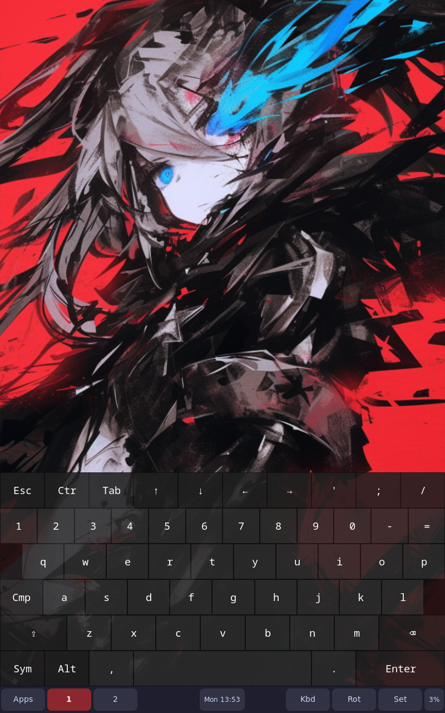
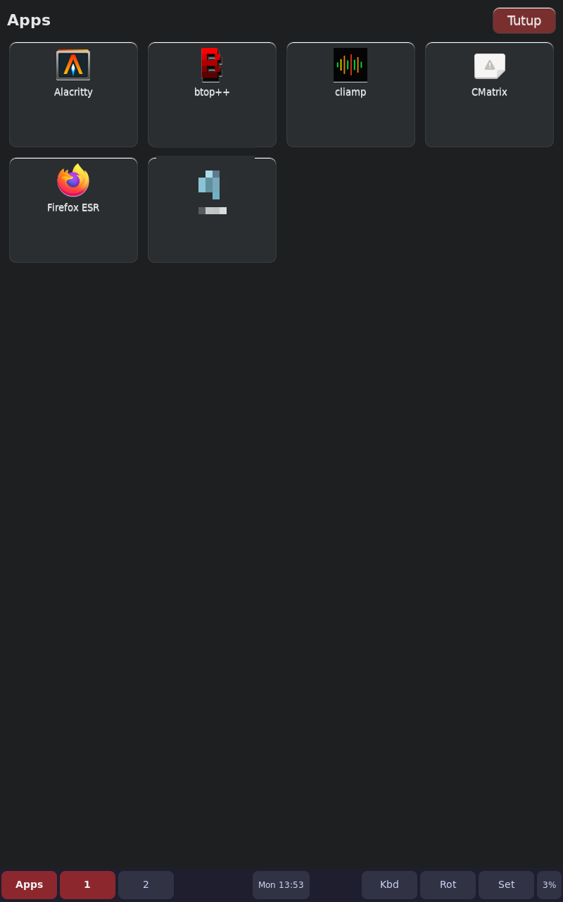
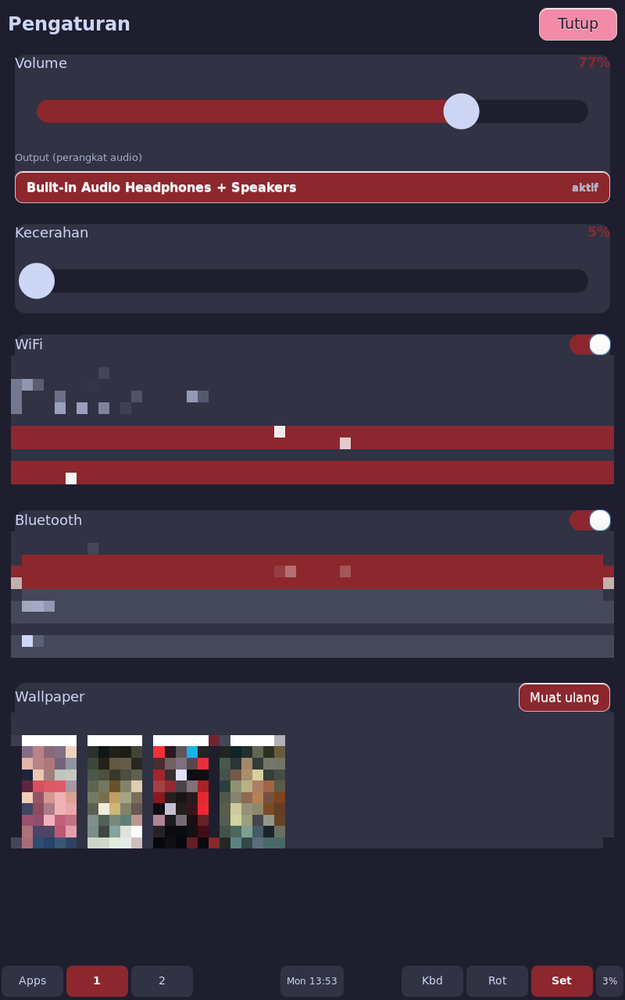

# sway-tablet
Sway customization for touchcreen only devices.
=======

Touch-first **sway** desktop for small tablets — dotfiles, helper scripts and the
waybar/on-screen-keyboard setup.

Originally written for the
[Wearness LP-E841](https://github.com/cicag/lp-w841_linux) (Intel Atom Z3735,
1 GB RAM, 800x1280 portrait), but the configuration is **device agnostic**:
paths are relative to `$HOME`, and the hardware-specific parts (touchscreen
mapping, backlight device, output name) are auto-detected or left commented
out.

This repo contains **only the desktop layer**. The device-level work (Debian
install, touchscreen firmware and calibration, backlight, power/thermal tuning,
kernel notes, Bluetooth gamepad) lives in the companion repo
**[`cicag/lp-w841_linux`](https://github.com/cicag/lp-w841_linux)**.

| | |
|---|---|
| Window manager | sway |
| Panel | waybar (bottom overlay, height 48) |
| On-screen keyboard | `wvkbd-mobintl` |
| Touch apps | `appmenu` (app grid), `controlpanel` (settings) |
| Theme | wallpaper-derived accent color, regenerated by `accent-update` |

## Install

The `config/` tree mirrors the **absolute paths on the device**, so restoring it
is a straight copy:

```sh
./install.sh                 # deploy as the current user
./install.sh --user alice    # deploy for another user
./install.sh --dry-run       # only show what would change
```

Manual equivalent:

```sh
cp -a config/home/.config/sway         ~/.config/
cp -a config/home/.config/waybar       ~/.config/
cp -a config/home/.config/pipewire     ~/.config/
cp -a config/home/.local/bin/*         ~/.local/bin/
```

Then start a session:

```sh
sway
```

This repo does **not** decide how the session starts. If you want the machine
to boot straight into sway (no display manager), see
[docs/01-desktop-sway.md](docs/01-desktop-sway.md#starting-a-session) — it
shows the getty autologin drop-in plus three ways to launch sway from it
(shell profile, systemd user unit, display manager).

### Requirements

Installed on the device (not provided by this repo):

- `sway`, `waybar`, `swaybg`, `wvkbd-mobintl`, `swaynag`
- `python3` + `PyGObject` (GTK3) for `appmenu` and `controlpanel`
- `wpctl`/`pipewire` (PipeWire) for audio, `nmcli` for WiFi, `bluetoothctl`
  for Bluetooth
- `libinput` + `wl-clipboard` for the touch/clipboard helpers

## Layout

```
config/               exact copies of the on-device files
  home/
    .config/
      sway/          config, autostart.sh, accent.conf, accent
      waybar/        config, style.css (style.css is generated)
      pipewire/      pipewire.conf.d/99-min-quantum.conf
    .local/bin/      helper scripts (see below)
docs/                desktop documentation
screenshots/         screenshots of the running desktop
```

> Files under `config/` mirror the on-device absolute paths.

## Scripts

| Script | Role |
|---|---|
| `accent-update` | derives an accent color from the wallpaper, rewrites `accent.conf` and the waybar stylesheet |
| `appmenu` | fullscreen GTK3 application grid, launched from the waybar |
| `controlpanel` | fullscreen GTK3 settings panel: volume, per-app volume, brightness, WiFi, Bluetooth, wallpaper |
| `powerkeyd` | power button: short press toggles the screen, long press shows the power dialog |
| `scrollbridge` | two-finger scrolling for the touchscreen (needs root) |
| `waybar-app-state.sh` | reports `on`/`off` for a GTK `app_id` |
| `waybar-app-toggle.sh` | launches an app, or kills it if already running |
| `waybar-kbd.sh` / `waybar-kbd-state.sh` | toggles the on-screen keyboard and reports its state |
| `waybar-rotate.sh` | cycles the output transform |
| `waybar-ws.sh` | workspace buttons for the waybar |

## Device-specific bits

Kept out of the shipped configuration on purpose — enable them per machine:

| What | Where | Note |
|---|---|---|
| Touchscreen → panel mapping | `~/.config/sway/local.conf` | included if present; set the device and output name for your hardware |
| Backlight device | `controlpanel` | auto-detected; `BACKLIGHT=/sys/class/backlight/<name>` overrides |
| Power key device / output | `powerkeyd` | auto-detected; `POWERKEY_DEVICE` / `POWERKEY_OUTPUT` override |
| On-screen keyboard size | `waybar-kbd.sh` | `WVKBD_HEIGHT` / `WVKBD_LAYOUT` |
| Renderer | session start | `WLR_RENDERER=vulkan` or `gles2` |
| `scrollbridge` sudo rule | `/etc/sudoers.d/scrollbridge` | installed by `lp-w841_linux/install.sh`; or add a `NOPASSWD` rule |

## Documentation

| Doc | Contents |
|---|---|
| [docs/01-desktop-sway.md](docs/01-desktop-sway.md) | Starting a session, sway config, autostart, theme, panel, touch apps, power key |

## Screenshots

Captured on the device with `grim` under the **GLES2** renderer (screen capture
does not work under the Vulkan renderer).

| Desktop (wallpaper + waybar + on-screen keyboard) | App grid | Settings panel |
|---|---|---|
|  |  |  |

## Notes

- The panel and the touch apps scale themselves from the current output
  transform, so the desktop works in portrait and landscape.
- `controlpanel` mirrors the real Bluetooth/WiFi state: the toggle only stays
  on when the adapter is actually up.
