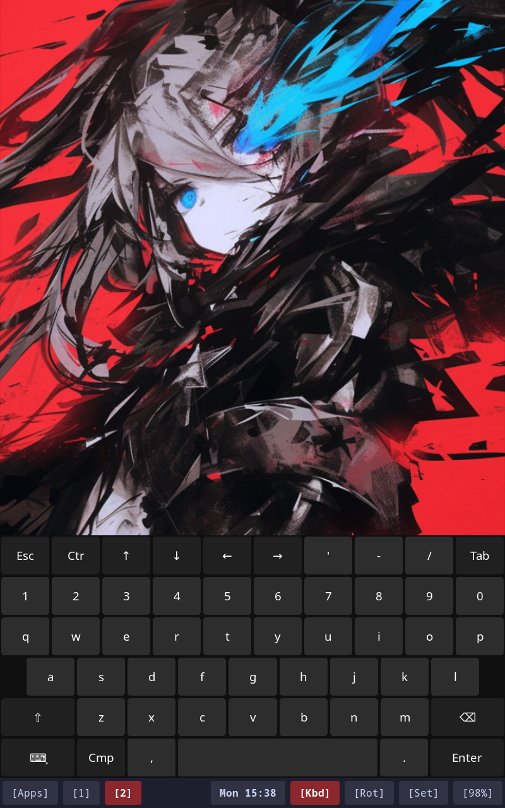
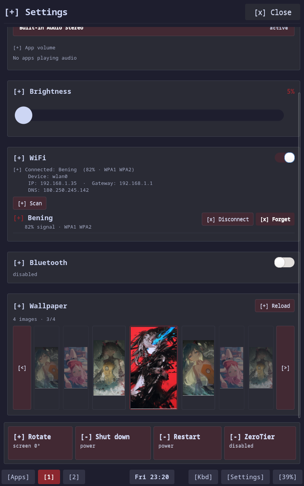
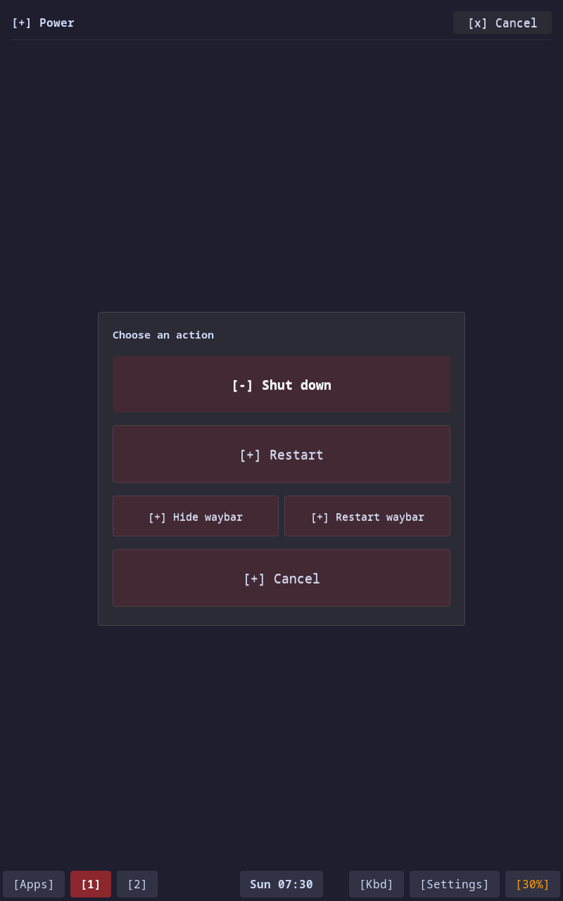
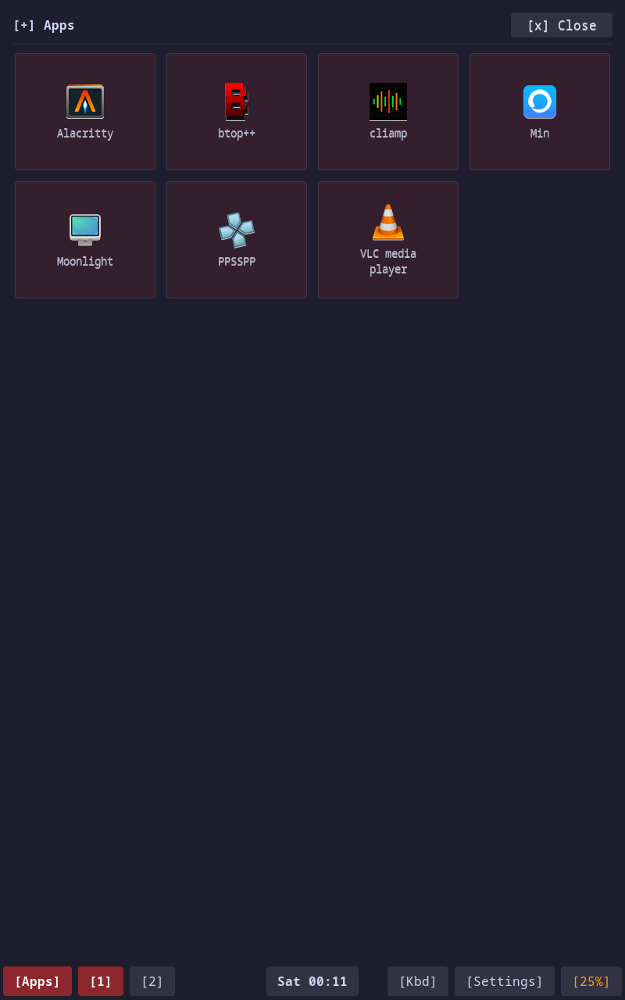

# sway-tablet

Touch-first **sway** desktop for small tablets — dotfiles, helper scripts and the
waybar/on-screen-keyboard setup.

Originally written for the
[Wearness LP-W841](https://github.com/cicag/lp-w841_linux) (Intel Atom Z3735,
1 GB RAM, 800x1280), but the configuration is **device agnostic**:
paths are relative to `$HOME`, and the hardware-specific parts (touchscreen
mapping, backlight device, output name) are auto-detected or left commented
out.

| | |
|---|---|
| Window manager | sway |
| Panel | waybar (bottom overlay, height 48) |
| On-screen keyboard | `wvkbd-mobintl` |
| Touch apps | `appmenu` (app grid), `controlpanel` (settings) |
| Theme | wallpaper-derived accent color, regenerated by `accent-update` |

## Install

The `config/` tree mirrors the **absolute paths on the device**, so restoring it
is a straight copy:

```sh
./install.sh                 # deploy as the current user
./install.sh --user alice    # deploy for another user
./install.sh --dry-run       # only show what would change
```

Manual equivalent:

```sh
cp -a config/home/.config/sway         ~/.config/
cp -a config/home/.config/waybar       ~/.config/
cp -a config/home/.config/pipewire     ~/.config/
cp -a config/home/.local/bin/*         ~/.local/bin/
```

Then start a session:

```sh
sway
```

This repo does **not** decide how the session starts. If you want the machine
to boot straight into sway (no display manager), see
[docs/01-desktop-sway.md](docs/01-desktop-sway.md#starting-a-session)

### Requirements

Installed on the device (not provided by this repo):

- `sway`, `waybar`, `swaybg`, `swaynag`
- `wvkbd-mobintl` **>= 0.16** (0.15 uses the top layer and is hidden
  behind fullscreen windows, so the keyboard cannot type into the control
  panel's password dialog; see
  [docs/02-troubleshooting.md](docs/02-troubleshooting.md#on-screen-keyboard-is-hidden-behind-fullscreen-windows))
- `python3` + `PyGObject` (GTK3) for `appmenu` and `controlpanel`
- `wpctl`/`pipewire` (PipeWire) for audio, `nmcli` for WiFi, `bluetoothctl`
  for Bluetooth
- `libinput` + `wl-clipboard` for the touch/clipboard helpers
- `lisgd` (optional) for touchscreen gestures via `sway-tablet-gestures` (3-finger swipes: workspace switch, close, fullscreen; auto-rotates with output transform)

## Layout

```
config/               exact copies of the on-device files
  home/
    .config/
      sway/          config, autostart.sh, accent.conf, accent
      waybar/        config, style.css (style.css is generated)
      pipewire/      pipewire.conf.d/99-min-quantum.conf
    .local/bin/      helper scripts (see below)
docs/                desktop documentation
screenshots/         screenshots of the running desktop
```

## Scripts

| Script | Role |
|---|---|
| `accent-update` | derives an accent color from the wallpaper, rewrites `accent.conf` and the waybar stylesheet |
| `appmenu` | fullscreen GTK3 application grid, launched from the waybar |
| `controlpanel` | fullscreen GTK3 settings panel |
| `orientation-daemon` | background accelerometer polling daemon that auto-rotates the sway output when orientation is unlocked (configured via env vars |
| `powerkeyd` | power button: short press toggles the screen, long press shows the power dialog |
| `sway-tablet-gestures` | manages `lisgd` 3-finger touchscreen gestures (workspace switch/close/fullscreen), restarts on output transform changes; `GESTURE_DEVICE` overrides auto-detection |
| `waybar-app-state.sh` | reports `on`/`off` for a GTK `app_id` |
| `waybar-app-toggle.sh` | launches an app, or kills it if already running |
| `waybar-kbd.sh` / `waybar-kbd-state.sh` | toggles the on-screen keyboard and reports its state |
| `waybar-rotate.sh` | cycles the output transform (manual override; orientation lock in the control panel owns auto-rotation) |
| `waybar-ws.sh` | workspace buttons for the waybar |

## Device-specific bits

Kept out of the shipped configuration on purpose — enable them per machine:

| What | Where | Note |
|---|---|---|
| Touchscreen → panel mapping | `~/.config/sway/local.conf` | included if present; set the device and output name for your hardware |
| Backlight device | `controlpanel` | auto-detected; `BACKLIGHT=/sys/class/backlight/<name>` overrides |
| Power key device / output | `powerkeyd` | auto-detected; `POWERKEY_DEVICE` / `POWERKEY_OUTPUT` override |
| On-screen keyboard size | `waybar-kbd.sh` | `WVKBD_HEIGHT` / `WVKBD_LAYOUT` |
| Renderer | session start | `WLR_RENDERER=vulkan` or `gles2` |
| Orientation sensor | `orientation-daemon` env vars | `SENSOR_PATH`, `OUTPUT_NAME`, `POLL_INTERVAL_MS`, `EMA_ALPHA`, `ORIENTATION_OFFSET` — set per machine |
| Touch gestures | `sway-tablet-gestures` | `GESTURE_DEVICE` to select touch device; `~/.config/swaytablet/gestures-disabled` to disable; `~/.config/swaytablet/gestures-orient.json` to override per-transform `lisgd -o` |

## Documentation

| Doc | Contents |
|---|---|
| [docs/01-desktop-sway.md](docs/01-desktop-sway.md) | Starting a session, sway config, autostart, theme, panel, touch apps, power key |
| [docs/02-troubleshooting.md](docs/02-troubleshooting.md) | Power key shutting down immediately (logind), waybar missing after login (portal activation), on-screen keyboard hidden behind fullscreen windows (wvkbd < 0.16), control panel not appearing (CSS placeholder mismatch) |
| [docs/03-appimage-appmenu.md](docs/03-appimage-appmenu.md) | Registering AppImages from `~/Applications` as app-menu entries via `.desktop` files, icons, examples and troubleshooting |
| [docs/04-orientation-lock.md](docs/04-orientation-lock.md) | Orientation lock: auto-rotate based on accelerometer when unlocked, hold orientation when locked |

## Screenshots

Captured on the device with `grim`.

| Desktop (wallpaper + waybar + on-screen keyboard) | Control panel | Power menu | App grid |
|---|---|---|---|
|  |  |  |  |
